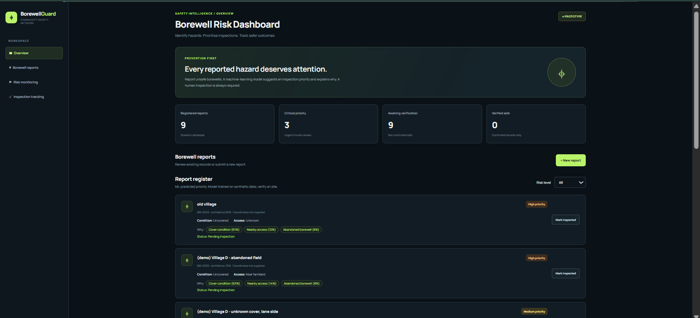
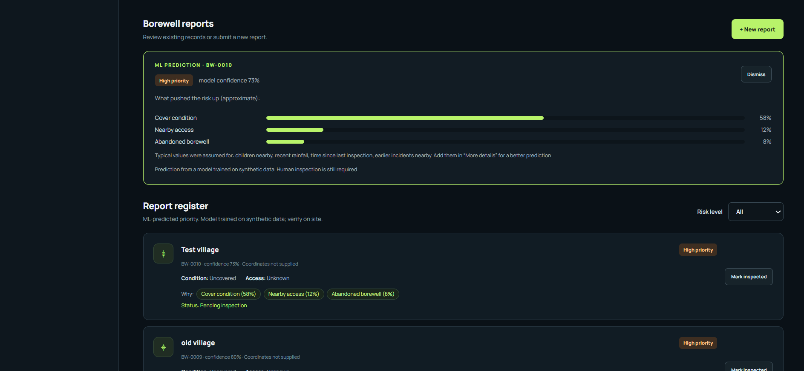
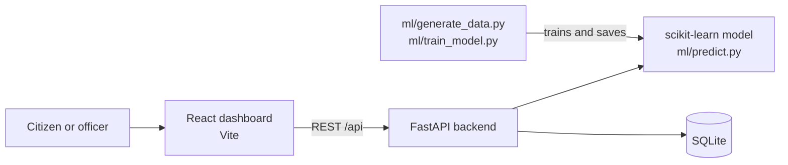

# BorewellGuard

**ML-assisted triage for unsafe borewell reports.** Citizens report an open or damaged borewell. A machine-learning model predicts an inspection priority (Low / Medium / High / Critical), explains which factors drove it, and the report is stored so officers can track inspections.

> **Honest scope note.** No public labelled dataset of borewell hazard reports exists, so the model is trained on **synthetic data** generated from a hand-designed hazard model (`ml/generate_data.py`). The metrics below show that the pipeline learns that encoded logic and beats the original rule-based scoring on it. They are **not** evidence of real-world field accuracy. The app is decision support only; a human inspection is always required.

**Live demo:** https://borewellguard-web.onrender.com  
API documentation: https://borewellguard-api.onrender.com/docs  
_Free hosting: after 15 minutes idle the server sleeps and the first load can take about a minute (the page shows a "waking up" message and retries). Reports submitted on the live demo are lost when the server restarts; the 8 labelled demo reports are re-created._

## Screenshots

| Dashboard | Prediction with explanation |
|---|---|
|  |  |

## What it does

- Report form with 3 required fields and optional details (people nearby, children nearby, abandoned, fence/marker, age, depth). Missing details get typical values, and the result says exactly which were assumed.
- ML risk prediction with probabilities and the top factors behind it.
- **Critical escalation:** if the chance of Critical is high enough, the report is raised to Critical as a precaution and labelled as such.
- Reports are stored in a database (SQLite); inspection status can be updated.
- Input validation on every field, and tests for the API and the ML module.

## Architecture



| Folder | Contents |
|---|---|
| `frontend/` | React + Vite dashboard and report form |
| `backend/` | FastAPI app (`app.py`), demo seeder (`seed_demo.py`) |
| `ml/` | Synthetic data generator, training and evaluation, prediction with explanations |
| `tests/` | pytest tests for the API and the ML module |

## Machine learning

**Data:** 6,000 synthetic reports, 11 features (cover condition, nearby access, people nearby, children nearby, age, depth, abandoned, fence/marker, 30-day rainfall, days since inspection, earlier incidents). Labels come from a hidden hazard model with feature interactions and noise, split into four classes (35 / 30 / 22 / 13 %).

**Models compared** on a stratified 80/20 split, best one chosen by 5-fold cross-validated macro-F1 (not by test score): Logistic Regression, Random Forest, Gradient Boosting, and the original rule-based `calculateRisk()` from the first version of the app.

**Critical escalation:** if P(Critical) >= a threshold, the report becomes Critical even when another class is more likely. The threshold (0.25) is chosen on out-of-fold *training* predictions to reach 92% Critical recall, then checked once on the held-out test set.

| Held-out test set (1,200 synthetic reports) | Accuracy | Macro-F1 | Critical recall | Critical precision |
|---|---|---|---|---|
| Rule-based (original app logic) | 51.3% | 0.510 | 90.4% | 42.1% |
| Logistic Regression | 79.2% | 0.781 | 74.4% | 82.9% |
| Random Forest | 78.7% | 0.782 | 78.8% | 84.8% |
| Gradient Boosting | 78.5% | 0.780 | 76.9% | 86.3% |
| **Logistic Regression + Critical escalation (used by the app)** | **79.0%** | – | **91.0%** | **72.8%** |

Reading the table: the ML model is far more accurate than the rule-based scoring and raises fewer false Critical alarms (precision 42% to 73%) while catching about as many truly Critical borewells (recall 90% to 91%). The trade-off against plain ML is lower Critical precision (83% to 73%) in exchange for much higher recall. The three ML models are within split-to-split noise of each other on this data.

Plots: [`ml/outputs/confusion_matrix.png`](ml/outputs/confusion_matrix.png), [`ml/outputs/feature_importance.png`](ml/outputs/feature_importance.png), [`ml/outputs/model_comparison.png`](ml/outputs/model_comparison.png). All numbers: [`ml/outputs/metrics.json`](ml/outputs/metrics.json).

**Explanations:** each factor is scored by switching it to a safe value (and, from a fully safe report, switching it on) on a log-odds scale. Effects that are negligible are not shown. This ignores feature interactions, so it is an approximation, not an exact attribution.

## Run it locally

Requires Python 3.10+ and Node 20+. On Windows use `py` instead of `python`.

```bash
# 1. Install backend and ML dependencies (from the repository root)
pip install -r requirements-dev.txt

# 2. Create the synthetic data and train the model (the model file is not committed)
cd ml
python generate_data.py
python train_model.py
cd ..

# 3. (optional) add clearly labelled demo reports
python -m backend.seed_demo

# 4. Start the API  ->  http://localhost:8000/docs
python -m uvicorn backend.app:app --reload --port 8000

# 5. In a second terminal, start the dashboard  ->  http://localhost:5173
cd frontend
npm install
npm run dev
```

Run the tests from the repository root: `python -m pytest -q` (the ML tests need step 2 first).

Configuration: `VITE_API_URL` (frontend, default `http://localhost:8000`), `ALLOWED_ORIGINS` (backend CORS for a deployed site), `DB_PATH` (SQLite file location), `SEED_DEMO=1` (add demo reports on startup when the database is empty).

## Deployment (Render, free tier)

- **API** (`borewellguard-api`, Web Service, Python): build `pip install -r requirements.txt && python ml/generate_data.py && python ml/train_model.py`, start `uvicorn backend.app:app --host 0.0.0.0 --port $PORT`, health check `/api/health`. Environment: `SEED_DEMO=1` (adds the labelled demo reports when the database is empty) and `ALLOWED_ORIGINS=<frontend URL>`.
- **Dashboard** (`borewellguard-web`, Static Site): root directory `frontend`, build `npm install && npm run build`, publish directory `dist`. Environment: `VITE_API_URL=<API URL>` (read at build time).
- The Python version is pinned in `.python-version`. The model is trained during the build, so no model file is committed.
- Free-tier behaviour: the API sleeps after 15 minutes without traffic, and its disk is ephemeral, so reports are lost on restart. A production deployment would use a managed database.

## API

| Method | Path | Purpose |
|---|---|---|
| GET | `/api/health` | Service and model status |
| POST | `/api/predict` | Prediction only, nothing saved |
| POST | `/api/reports` | Predict and save a report |
| GET | `/api/reports` | List reports (filters: `risk`, `status`) |
| GET | `/api/reports/{id}` | One report |
| PATCH | `/api/reports/{id}/status` | Update inspection status |
| GET | `/api/stats` | Counts by risk level and status |

Interactive documentation is served at `/docs`.

## Limitations

- Synthetic training data (see the scope note above). Replace `ml/data/synthetic_borewell_reports.csv` with real inspection records in the same columns and re-run `train_model.py` to get honest real-world metrics.
- The escalation threshold and the explanation floor were tuned on synthetic data and would need re-tuning on real data.
- The ML model predicts a level below the true one more often than the rule-based scoring does (9.3% vs 2.3% of test reports, almost always by one level), because the rule-based scoring errs towards over-flagging, which is also why its Critical precision is only 42%. Critical escalation is what keeps Critical recall level with the rule-based scoring.
- The live demo stores reports in SQLite on an ephemeral disk, so they do not survive a restart. No authentication, and SQLite suits a single server only. Both would change for a real deployment.
- Location is free text with optional coordinates; there is no map or photo input yet.

## Safety

Never approach an open borewell to collect information. Report it from a safe distance. Predictions are decision support for prioritising inspections, not a safety guarantee.
